# Autosubmit PostgreSQL benchmark

## Overview

| Test | Experiments | Schemas | Relations | Attributes | Indexes | Constraints | Dependencies | Database (MiB) |
|---|---:|---:|---:|---:|---:|---:|---:|---:|
| T0-PG | 0 | 4 | 415 | 3,161 | 0 | 194 | 1,725 | 7.49 |
| T0-AS | 0 | 4 | 428 | 3,243 | 3 | 208 | 1,769 | 7.63 |
| T1 | 1 | 5 | 488 | 3,702 | 19 | 300 | 1,993 | 8.48 |
| T2 | 10 | 14 | 983 | 7,545 | 154 | 1,074 | 3,856 | 14.22 |
| T3 | 100 | 104 | 5,933 | 45,975 | 1,504 | 8,814 | 22,486 | 71.45 |
| T4 | 1,000 | 1,004 | 55,433 | 430,275 | 15,004 | 86,214 | 208,786 | 644.18 |
| T5 | 5,000 | 5,004 | 275,433 | 2,138,275 | 75,004 | 430,214 | 1,036,786 | 3,190.58 |
| T6 | 10,000 | 10,004 | 550,433 | 4,273,275 | 150,004 | 860,214 | 2,071,786 | 6,374.18 |

## Query execution times

| Test | Experiments | Query | Execution time (ms) |
|---|---:|---|---:|
| T0-PG | 0 | Schemas | 1.070 |
| T0-PG | 0 | Relations | 0.315 |
| T0-PG | 0 | Attributes | 0.339 |
| T0-PG | 0 | Dependencies | 0.266 |
| T0-PG | 0 | Indexes | 0.134 |
| T0-PG | 0 | Schema listing | 0.108 |
| T0-AS | 0 | Schemas | 1.027 |
| T0-AS | 0 | Relations | 0.265 |
| T0-AS | 0 | Attributes | 0.378 |
| T0-AS | 0 | Dependencies | 0.309 |
| T0-AS | 0 | Indexes | 0.148 |
| T0-AS | 0 | Schema listing | 0.114 |
| T1 | 1 | Schemas | 0.948 |
| T1 | 1 | Relations | 0.272 |
| T1 | 1 | Attributes | 0.389 |
| T1 | 1 | Dependencies | 0.290 |
| T1 | 1 | Indexes | 0.145 |
| T1 | 1 | Schema listing | 0.114 |
| T2 | 10 | Schemas | 0.949 |
| T2 | 10 | Relations | 0.368 |
| T2 | 10 | Attributes | 0.853 |
| T2 | 10 | Dependencies | 0.442 |
| T2 | 10 | Indexes | 0.173 |
| T2 | 10 | Schema listing | 0.108 |
| T3 | 100 | Schemas | 1.040 |
| T3 | 100 | Relations | 0.866 |
| T3 | 100 | Attributes | 4.353 |
| T3 | 100 | Dependencies | 1.645 |
| T3 | 100 | Indexes | 0.402 |
| T3 | 100 | Schema listing | 0.177 |
| T4 | 1,000 | Schemas | 1.404 |
| T4 | 1,000 | Relations | 5.567 |
| T4 | 1,000 | Attributes | 33.138 |
| T4 | 1,000 | Dependencies | 10.387 |
| T4 | 1,000 | Indexes | 2.814 |
| T4 | 1,000 | Schema listing | 0.581 |
| T5 | 5,000 | Schemas | 2.985 |
| T5 | 5,000 | Relations | 26.820 |
| T5 | 5,000 | Attributes | 84.853 |
| T5 | 5,000 | Dependencies | 40.205 |
| T5 | 5,000 | Indexes | 14.473 |
| T5 | 5,000 | Schema listing | 2.309 |
| T6 | 10,000 | Schemas | 4.673 |
| T6 | 10,000 | Relations | 42.902 |
| T6 | 10,000 | Attributes | 152.591 |
| T6 | 10,000 | Dependencies | 50.909 |
| T6 | 10,000 | Indexes | 16.048 |
| T6 | 10,000 | Schema listing | 3.902 |

## System resource metrics

| Test | Experiments | PostgreSQL RSS (MiB) | Memory available (GiB) | Memory used (%) | CPU busy (%) | PGDATA (GiB) |
|---|---:|---:|---:|---:|---:|---:|
| T0-PG | 0 | 181.65 | 13.65 | 11.14 | 0.75 | 48572964 |
| T0-AS | 0 | 181.65 | 13.61 | 11.44 | 0.25 | 48720420 |
| T1 | 1 | 220.86 | 13.62 | 11.35 | 0.38 | 66626432 |
| T2 | 10 | 223.27 | 13.62 | 11.32 | 0.92 | 72659909 |
| T3 | 100 | 226.67 | 13.60 | 11.50 | 0.48 | 149574953 |
| T4 | 1,000 | 520.49 | 13.26 | 13.73 | 0.30 | 993511385 |
| T5 | 5,000 | 915.55 | 12.08 | 21.36 | 0.88 | 3582012516 |
| T6 | 10,000 | 1051.08 | 11.23 | 26.92 | 0.20 | 6825129061 |

## Catalog objects per experiment

| Test | Experiments | Relations/experiment | Attributes/experiment | Indexes/experiment |
|---|---:|---:|---:|---:|
| T1 | 1 | 488.00 | 3702.00 | 196.00 |
| T2 | 10 | 98.30 | 754.50 | 43.00 |
| T3 | 100 | 59.33 | 459.75 | 27.70 |
| T4 | 1,000 | 55.43 | 430.27 | 26.17 |
| T5 | 5,000 | 55.09 | 427.65 | 26.03 |
| T6 | 10,000 | 55.04 | 427.33 | 26.02 |

## Plots

### 01_schema_growth

### 02_attributes

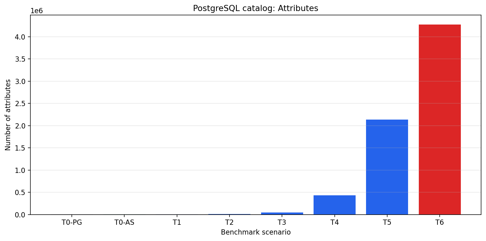

### 02_constraints

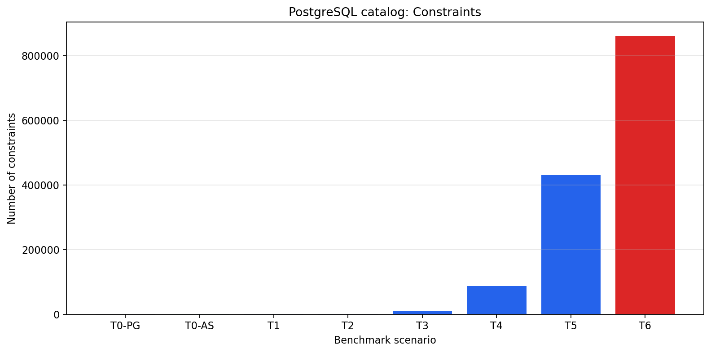

### 02_dependencies

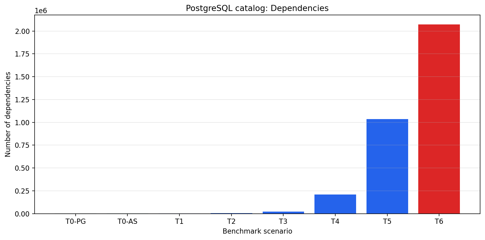

### 02_indexes

### 02_relations

### 02_types

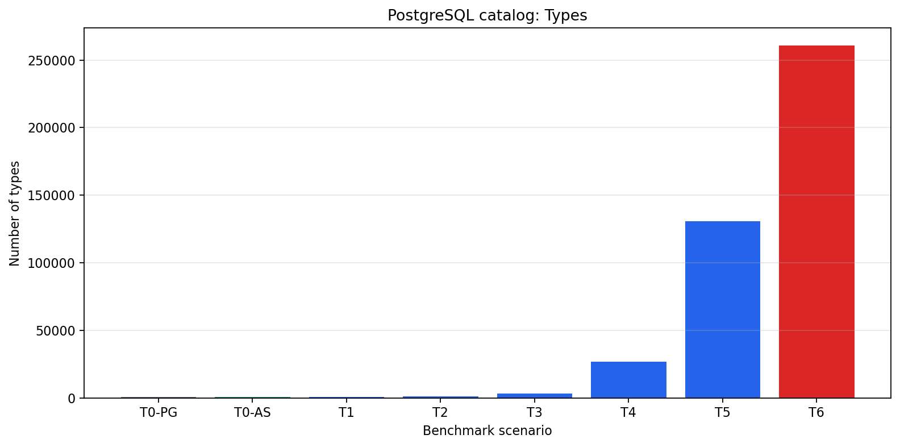

### 03_database_size

### 04_catalog_sizes

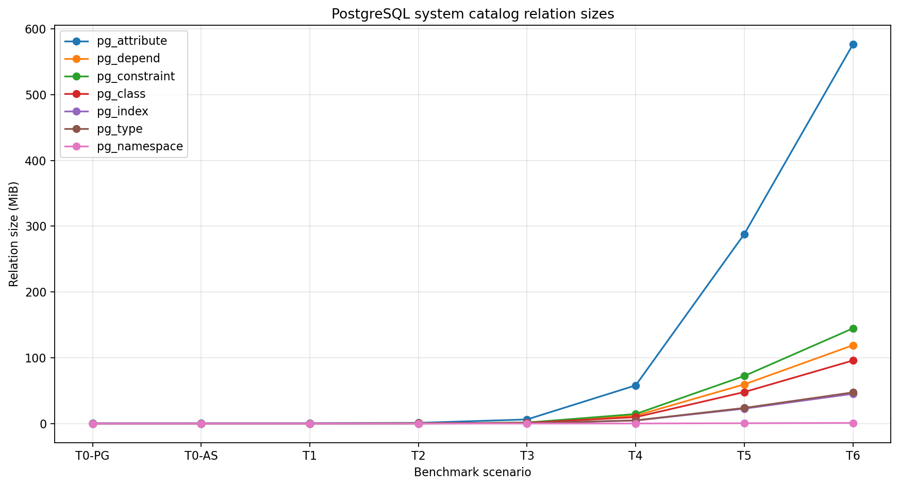

### 05_query_performance

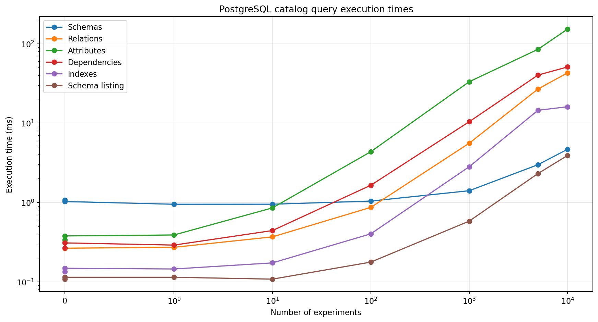

### 06_postgresql_memory

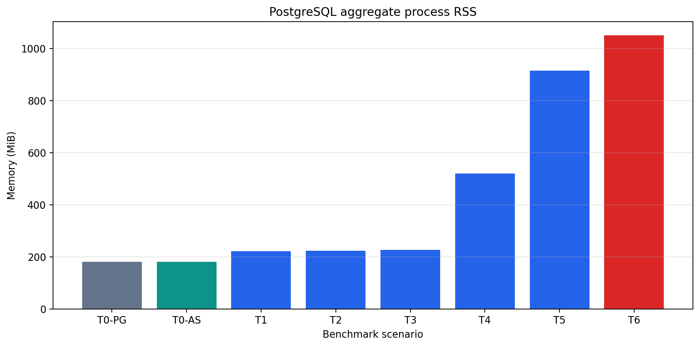

### 06b_postgresql_memory_scaling

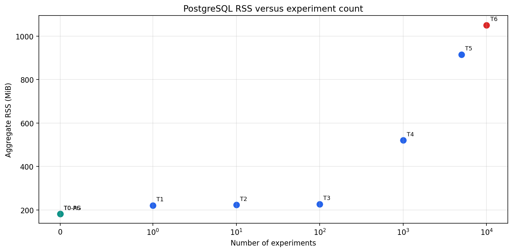

### 07_system_memory

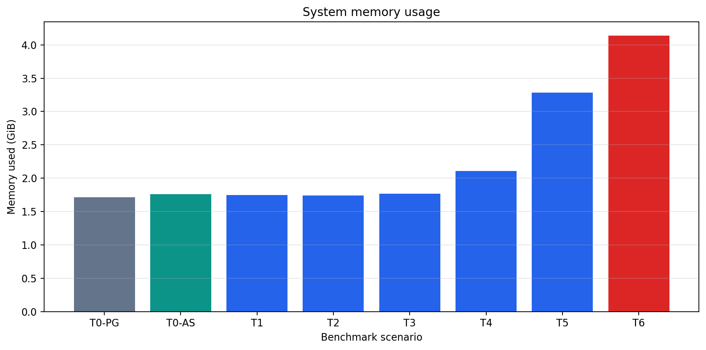

### 08_memory_available

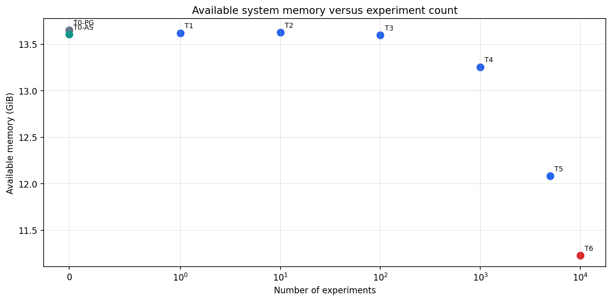

### 09_memory_utilisation

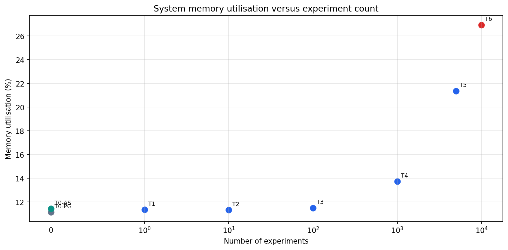

### 10_cpu_utilisation

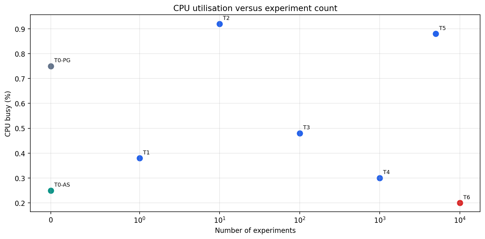

### 11_postgresql_storage

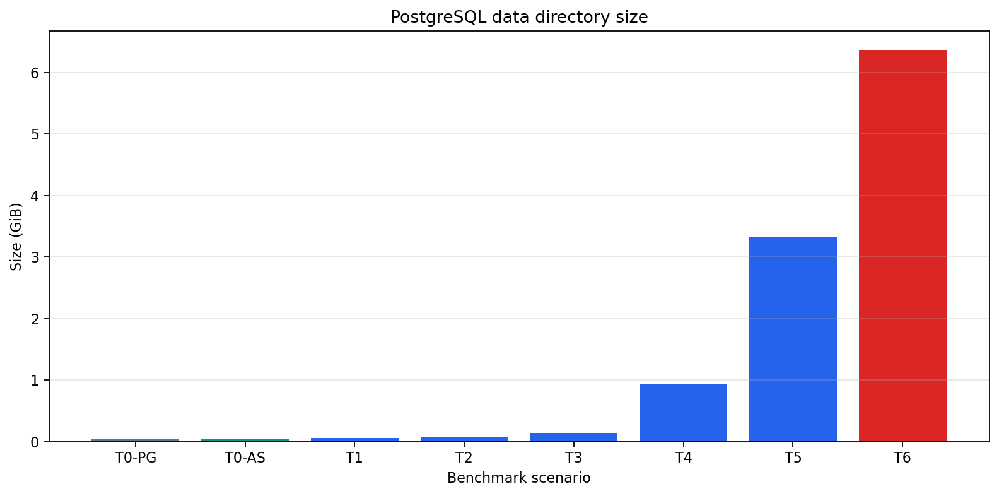

### 12_attributes_scaling

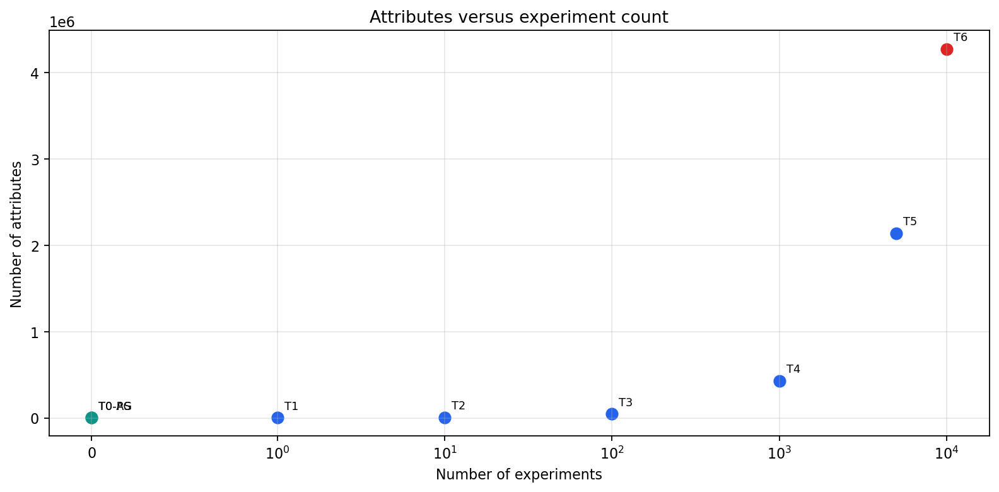

### 12_dependencies_scaling

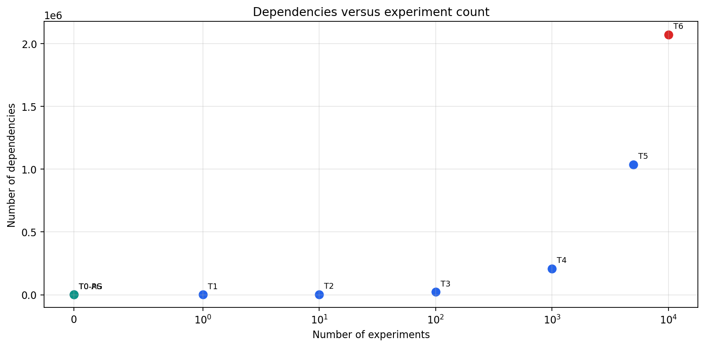

### 12_indexes_scaling

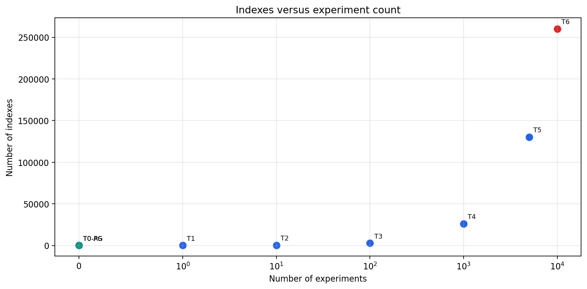

### 12_relations_scaling

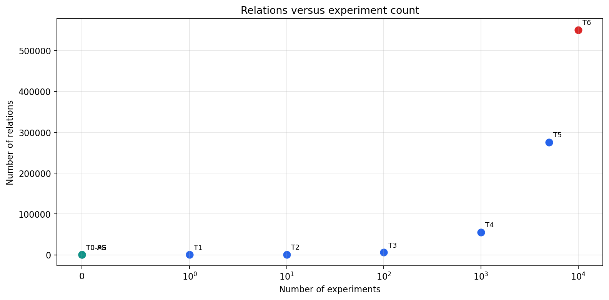

### 13_objects_per_schema

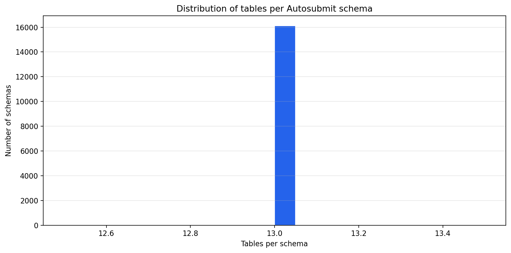

## Notes

- T0-PG represents the PostgreSQL installation baseline.
- T0-AS represents PostgreSQL with Autosubmit installed.
- T1-T6 represent increasing experiment counts.
- Missing measurements are represented as N/A, not zero.
- PostgreSQL RSS is the aggregate RSS of PostgreSQL processes. It is not equivalent to unique physical memory consumption.
- System memory utilisation is calculated as (total - available) / total.
- CPU busy is calculated as 100 - average CPU idle.
- CPU and memory figures represent collected snapshots, not continuous peak measurements.
- Query timings are individual measurements, not averages of repeated benchmark runs.
- PostgreSQL catalog total sizes can overlap because pg_total_relation_size includes indexes and TOAST storage.
- Catalog objects per experiment are aggregate counts divided by experiment count.
- These results measure database size and resource snapshots, not concurrent operational workload capacity.
